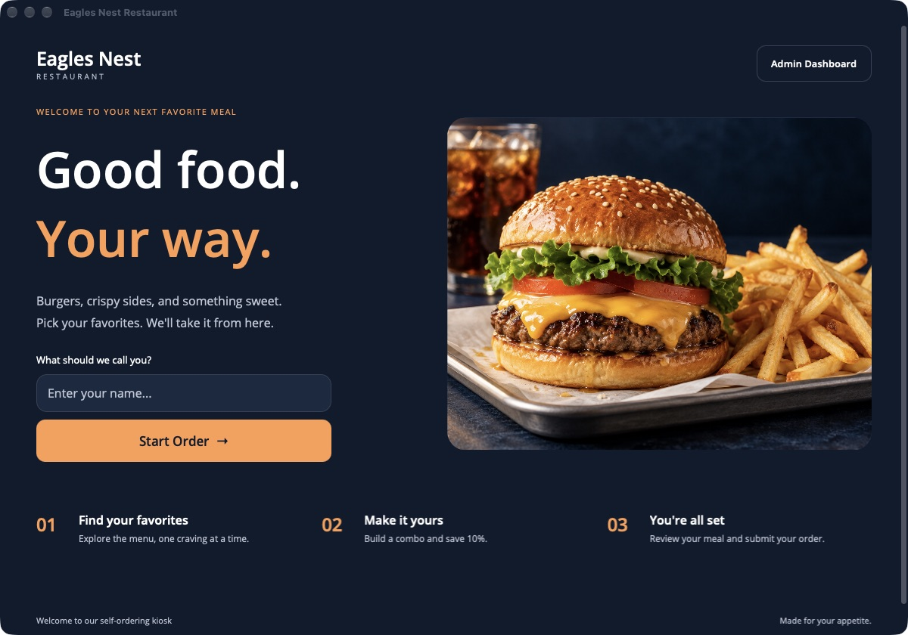

# Eagles Nest Restaurant

A native .NET MAUI self-ordering kiosk with a local SQLite menu, custom meal combos, and an order review flow.



## Run on macOS

Requires the .NET 9 SDK, MAUI Mac Catalyst workload, and Xcode.

```sh
dotnet workload install maui-maccatalyst
./scripts/run-mac.sh
```

The project also contains Android, iOS, and Windows targets. Those platforms need their own SDKs and device validation; a successful Mac build does not validate them.

## Ordering

Enter an optional name, start an order, and choose entrees, sides, drinks, desserts, or appetizers. A combo includes an entree, side, and drink with a 10% discount. Sized items add 25% for medium or 75% for large. Select a cart item to remove it, or review the order at checkout. Tax is 7%; tips are optional. Completing an order clears the cart and returns to welcome.

The admin dashboard supports search, category/size filters, and local menu creation, editing, and deletion. This remains an unrestricted local demo dashboard, not authenticated restaurant administration.

## Display behavior

- Native Mac interface sizing (`UIDeviceFamily=6`) avoids the default scaled iPad presentation.
- Text remains native, with bundled Open Sans fonts. Pages do not apply bitmap or whole-page scaling.
- Main content stays within 1440 points on large monitors; selection and checkout pages use narrower reading widths.
- Below 780 points, the welcome photograph moves below the form and the cart moves below the menu. Below 500 points, category buttons become a single column.
- Long menus and orders scroll. Selected, empty, loading, and disabled states are explicit.
- Mac buttons use the kiosk's full touch-sized surface without the compact system bezel.

## Checks and visual QA

```sh
dotnet run --project tests/EaglesNest.CoreChecks
```

The console checks run the application's real models, controllers, and SQLite implementation against a temporary database. They cover stable cart IDs, deletion, isolated order copies, sized items, combos, taxes/tips, and menu persistence.

For isolated native visual QA in a Debug build:

```sh
EAGLESNEST_DATA_DIR="$PWD/.tmp/kiosk-data" EAGLESNEST_QA_WINDOW=390x800 ./scripts/run-mac.sh
```

`EAGLESNEST_DATA_DIR` selects an alternate database directory. Without it, the app uses the existing MAUI app-data directory and preserves the installed menu. `EAGLESNEST_QA_WINDOW` fixes a Debug window's native point dimensions for reproducible narrow/desktop/large-window checks; leave it unset for normal resizing.

## Portfolio

Native screenshots are in [`docs/portfolio`](docs/portfolio). Food photography is AI-generated and illustrative. This is a local ordering demo: no payments are collected and orders are not delivered to a kitchen.
